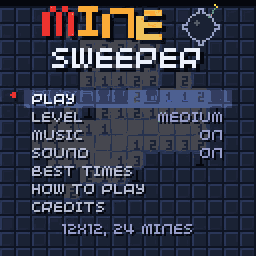

# Minesweeper

[](https://github.com/chili-chip/chili-minesweeper/actions/workflows/build.yml)

The classic logic puzzle for the ChiliChip **VGC Zero** (128x128), built on the
[chilichip fork of the 32blit SDK](https://github.com/chili-chip/32blit-sdk).
It also runs on desktop (SDL) and in the browser: [play it on chilichip.eu](https://chilichip.eu/games/minesweeper/).



Numbers tell you how many mines touch each cell. Flag the mines and reveal everything else as
fast as you can. Your first reveal is always safe and always opens an area.

## Features

- Four levels: **Easy** 9x9 with 10 mines, **Medium** 12x12 with 24, **Hard** 16x15 with 40 and
  **Expert** 16x15 with 50. Smaller boards get bigger cells.
- Chording: press A (or B) on a number once all its mines are flagged to open the cells around it.
- Top-five best times per level with 3-letter initials, plus games won and win streaks.
- Original chiptune soundtrack (title theme, a calm in-game loop that picks up as the board
  clears, win and lose jingles) and sound effects, all synthesised on the 32blit audio channels.
  Music and sound can be turned off in the menu.
- Ripple reveals, a chain-reaction explosion with screen shake, confetti on a win, and a
  self-playing board behind the menus.
- Pause hides the board, so no peeking while the clock is stopped.

Settings, best times and stats are saved.

## Controls

| Button | Menu | In game | After a win or loss |
| --- | --- | --- | --- |
| D-pad | Choose an option, left/right changes it | Move the cursor (hold to repeat, wraps at the edges) | |
| A | Select | Reveal the cell, or chord on a number | Play again |
| B | Back | Flag or unflag the cell, or chord on a number | Back to the menu |
| MENU | Back | Pause (resume, restart or quit) | Back to the menu |

On desktop: arrow keys or WASD, **Z** = A, **X** = B, **Esc** = MENU.

## Code layout

| File | What |
| --- | --- |
| `src/game.cpp` | 32blit `init`/`update`/`render`, scenes (menu, play, pause, results, name entry) |
| `src/board.cpp` | Board rules: mine placement, flood reveal, flags, chording, win and loss. No 32blit dependency |
| `src/render.cpp` | Drawing: cells, header, effects, logo and text helpers |
| `src/audio.cpp` | Soundtrack sequencer and sound effects |
| `src/save.cpp` | Levels, settings, best times and stats |
| `tests/` | Host-side unit tests for the board rules |
| `tools/make_art.py` | Generates the launcher splash and icon |
| `assets/sprites.png` | Header faces |

Only `src/` is compiled; the top-level `game.cpp` / `game.hpp` are unused leftovers from the template.

## Tests

The board rules build and run on the host without the SDK:
```
cmake -S tests -B build-tests
cmake --build build-tests
ctest --test-dir build-tests --output-on-failure
```
CI runs them on every push.

## Building

New to the SDK? Start with the [Linux quickstart](https://chilichip.eu/docs/game-sdk/quickstart/linux-quickstart/) on chilichip.eu. It installs the toolchain and clones `32blit-sdk`, `pico-sdk` and `pico-extras` next to this repo. CMake 3.28 or newer is needed for the presets in `CMakePresets.json`.

Desktop (SDL):
```
mkdir build && cd build
cmake -D32BLIT_DIR=../../32blit-sdk ..
make
./minesweeper
```

VGC Zero:
```
mkdir build.vgc && cd build.vgc
cmake .. \
  -D32BLIT_DIR=../../32blit-sdk \
  -DPICO_SDK_PATH=../../pico-sdk \
  -DPICO_BOARD=chilichip_vgc \
  -DPICO_PLATFORM=rp2350-arm-s \
  -DCMAKE_TOOLCHAIN_FILE=../../32blit-sdk/pico2.toolchain
make
```
This produces a `.uf2` you can copy onto the console's `RP2350` drive. To build an installable `.blit` for the VGC Zero loader instead, add `-DBLIT_EXECUTABLE_PICO_BLIT=1` and install it with `32blit install minesweeper.blit`. See the [VGC build guide](https://github.com/chili-chip/32blit-sdk/blob/master/docs/vgc.md) for details, including flashing over SWD.

## Licence

MIT, see [LICENSE](LICENSE).

The project setup comes from the [32blit boilerplate](https://github.com/32blit/32blit-boilerplate), and the game runs on the [32blit SDK](https://github.com/32blit/32blit-sdk) (MIT, © Pimoroni Ltd and the 32blit contributors). Thanks to them.
